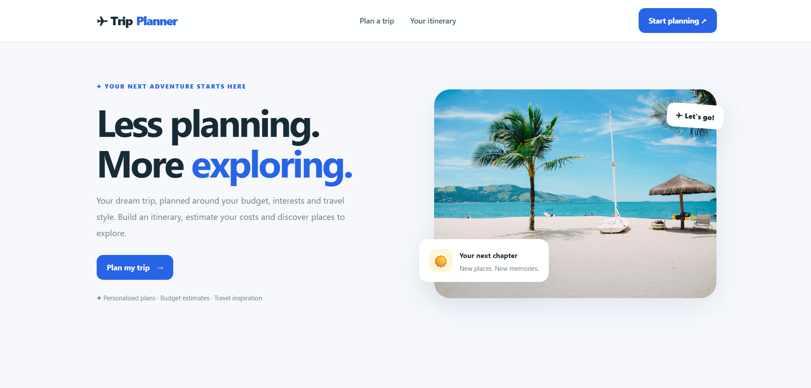
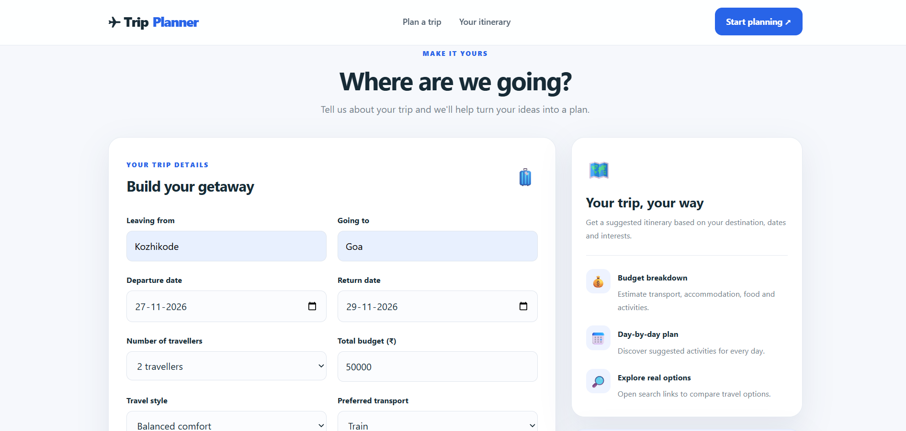
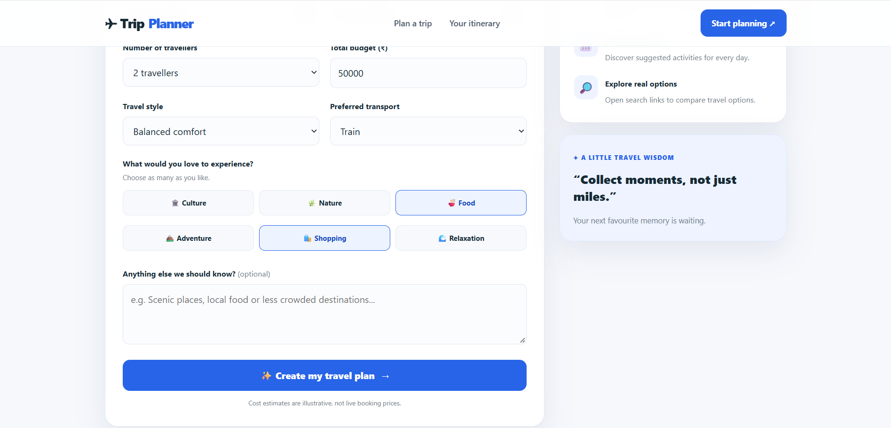
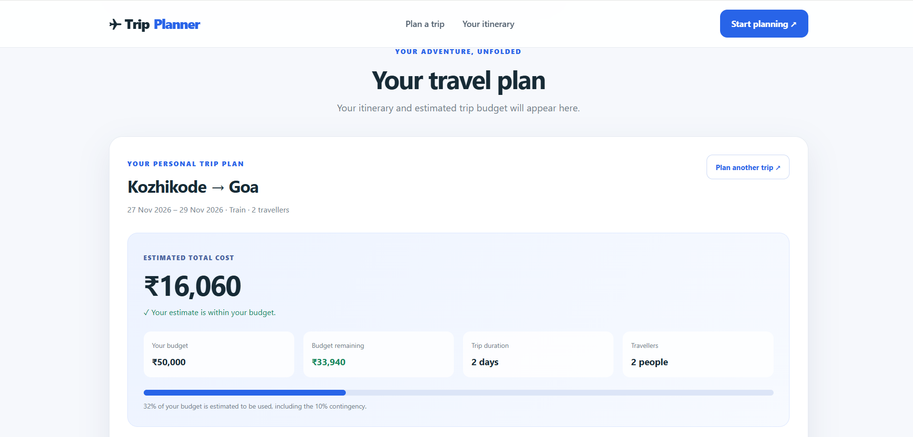
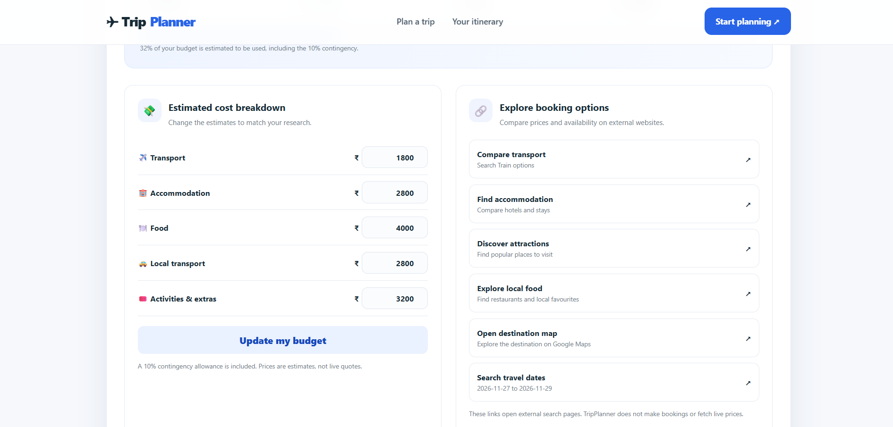

# TripPlanner - Travel Plan and Budget Estimator

## Live Website: https://parvanamohan.github.io/TripPlanner/

## Project Overview

TripPlanner is a web-based travel planning tool that helps users turn a trip idea into a simple plan. Users enter where they are going, their dates, budget and interests, and the website creates an estimated trip budget and a day-by-day itinerary.

It is a student project built with basic web technologies. No backend, database or installation is needed.

---

## Main Features

### 1. Trip Details Form
Users enter their departure city, destination, travel dates, number of travellers, total budget, travel style and preferred transport.

### 2. Interest-Based Planning
Users choose what they enjoy: culture, nature, food, adventure, shopping or relaxation. The itinerary changes based on these choices.

### 3. Estimated Trip Budget
The website estimates costs for:

- Transport
- Accommodation
- Food
- Local transport
- Activities and extras

A 10% contingency allowance is added to the total.

### 4. Budget Check
TripPlanner compares the estimated total with the user's budget. It shows the money remaining and a progress bar, and warns the user if the estimate goes over budget.

### 5. Editable Costs
Users can change any estimated cost to match their own research and select **Update my budget** to see the totals recalculated.

### 6. Day-by-Day Itinerary
Each day gets a suggested plan with activities that match the selected interests. The first day covers arrival and the last day covers the return journey.

### 7. Booking Search Links
The website creates ready-made search links for transport, hotels, attractions, local food and maps, so users can compare real options on external websites.

### 8. Print or Save as PDF
The final plan can be printed or saved as a PDF.

### 9. Input Checks
The form checks for mistakes such as a past departure date, a return date before departure, matching origin and destination, or a very low budget, and shows a clear message.

### 10. Responsive Design
The website works on desktops, laptops, tablets and mobile phones.

---

## Technologies Used

- **HTML5** - structure and content of the website.
- **CSS3** - styling, layout and responsive design.
- **JavaScript** - form validation, cost calculation, itinerary creation and dynamic results.

---

## Project Structure

```text
TripPlanner/
│
├── index.html
├── style.css
├── script.js
├── Screenshots/
│   ├── Homepage.png
│   ├── tripform.png
│   ├── create.png
│   ├── plan.png
│   ├── cost.png
│   └── day by day.png
│
└── README.md
```

---

## How the Planner Works

```text
Trip Details
    ↓
Validation Checks
    ↓
Cost Estimation (rates × days × travellers)
    ↓
Budget Comparison
    ↓
Day-by-Day Itinerary
    ↓
Booking Search Links
```

The estimate is based on the travel style (budget, balanced or comfort), the preferred transport, the number of days and the number of travellers.

---

## Example Workflow

1. Open the TripPlanner website.
2. Enter your departure city, destination and travel dates.
3. Choose the number of travellers, budget, travel style and transport.
4. Select your interests and add any notes.
5. Select **Create my travel plan**.
6. Review the estimated cost and remaining budget.
7. Edit the cost estimates if needed and update the budget.
8. Read the day-by-day itinerary.
9. Use the search links to compare real prices and options.
10. Print or save the plan as a PDF.

---

## Screenshots

| Home Page | Trip Form |
|:---:|:---:|
|  |  |

| Creating the Plan | Trip Plan Overview |
|:---:|:---:|
|  |  |

| Cost Breakdown | Day-by-Day Itinerary |
|:---:|:---:|
|  |  |

## Methodology

TripPlanner is an **educational prototype**. The costs and activity suggestions come from simplified built-in estimates, not from live prices or booking systems. Please check real prices before making any travel decisions.

---

## Future Enhancements

- AI agents for flights, stays and activities that build the plan together
- Live flight and hotel prices from travel APIs
- Saved trips and trip history
- Dark mode
- Maps and weather for the destination
- Support for more currencies and languages

---

## Disclaimer

TripPlanner is a student project made for learning purposes. It does not make bookings and its cost estimates should not be treated as real quotes.

---

## Author

Made by [Parvana Mohan](https://github.com/ParvanaMohan)
